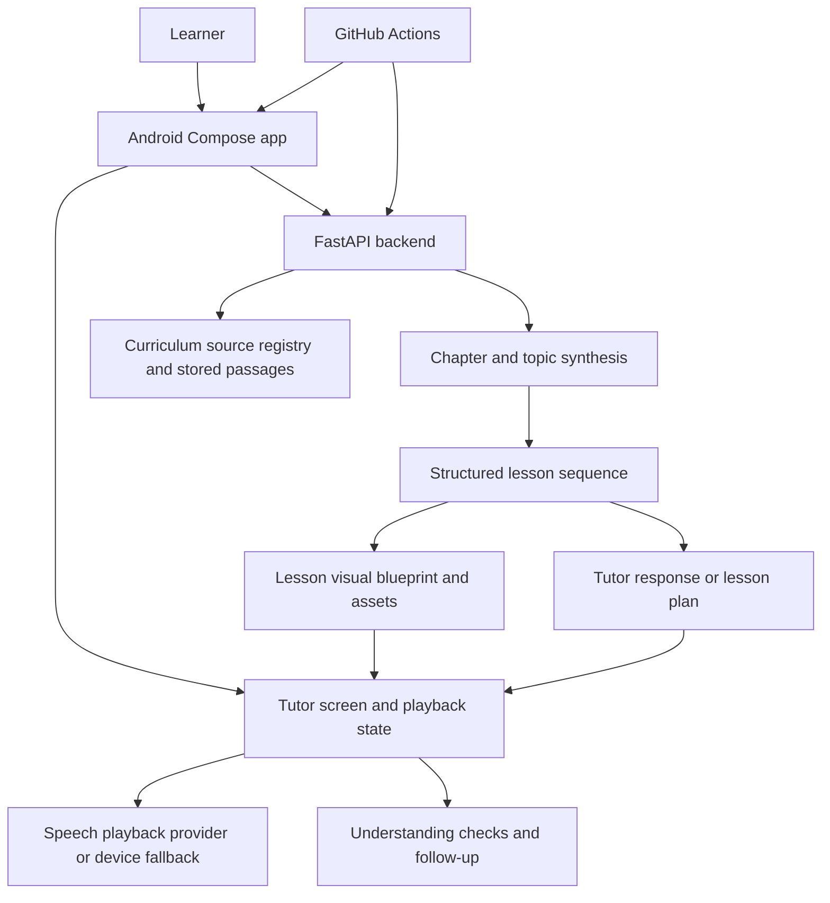

# System map — current high-level flow

This map is intentionally conservative. It describes the intended/current repository boundaries, not a claim that every path is fully production-ready.

## Intended teaching path
1. Learner profile and selected curriculum context enter the Android tutor flow.
2. Backend resolves the requested curriculum context and retrieves relevant stored source material where available.
3. Synthesis/lesson planning creates structured concepts and teaching steps with source references.
4. Visual generation maps the saved teaching step to a labelled, constrained visual representation.
5. Tutor response, caption, visual, and speech are presented in the same lesson flow.
6. Learner questions/checkpoints provide feedback for explanation or reteaching.

## Required integrity checks at each boundary
- **Profile -> retrieval:** board, class, subject, medium, edition/year, chapter and topic must be exact; no cross-chapter leakage.
- **Source -> synthesis:** source IDs/page references must be retained; unsupported claims must not be presented as official textbook facts.
- **Synthesis -> visual:** each visual must map to the exact saved teaching step and source evidence; stale assets must not be attached.
- **Backend -> Android:** validate response schema and supported visual/action types; fail safely on malformed or unknown actions.
- **Speech -> visual timeline:** synchronize at the level supported by actual playback callbacks/timestamps; do not invent word-level timing.
- **Learner -> evaluation:** questions should reveal understanding or misconceptions, not merely reward button tapping.

## Unknowns to resolve
The exact route schemas, production persistence provider, queue/background processing, retry/idempotency contracts, and current deployment topology are not fully documented here. Inspect and record these before making architectural changes.
